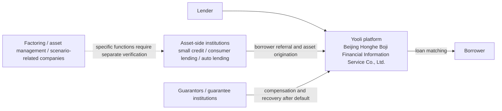

# Yooli Asset-Side and Related-Company Structure

> Updated: 2026-10-16  
> Chinese original: [`有利网资产端与关联公司结构梳理.md`](../docs/有利网资产端与关联公司结构梳理.md)  
> This article supplements the parts of the investigation that previously received less attention: where Yooli's loan assets came from, which companies performed borrower sourcing, asset management, factoring, or scenario-based services, and how those companies related to the platform operating entity.
>
> **Important evidentiary note:** this article strictly separates relationships confirmed by corporate-registration records, relationships supported by public reporting or court decisions, and relationships inferred only from company names or business context. A company being within the broader Yooli ecosystem does not prove that it held any particular pool of lender claims. Likewise, a company name containing “factoring” or “asset management” does not prove that it actually held Yooli lenders' underlying claims.
>
> This English version is a research translation. If wording differs, the Chinese original controls.

## 1. What “the asset side” meant in Yooli's business model

In its early years, Yooli did not itself perform all borrower acquisition and offline credit operations. Its model was broadly an online platform working with offline asset-originating institutions.

A 2015 *Yicai* report on Yooli's strategic adjustment said that, during the platform's early development, different founders were responsible for resources, online traffic, and offline assets, and that Wu Yiran had long been responsible for the asset side. As the business expanded, Yooli increasingly viewed exclusive reliance on external partners as weakening its control over asset quality. It therefore planned to extend from a “pure platform” toward the asset side, with emphasis on **auto loans, small credit loans, and consumer loans**, and to build a “platform + vertical asset-side” system through business lines branded as Yooli Puhui, Yooli Investment, Yooli Capital, and related entities.

By 2016, multiple financial-media reports described Yooli as acquiring and integrating offline asset-originating institutions, with the stated goal of building a “credit factory.” Public reports said Yooli's consumer-finance assets at the time included 3C products, mobile phones, electric vehicles, and other small-ticket consumer scenarios, later expanding into travel, beauty, and similar areas.

Accordingly, analysis of Yooli's later risk cannot be confined to `yooli.com` or the platform operating company alone. The public record indicates a more complex network of borrower sourcing, borrower referral, guarantees/compensation, collection, and asset management behind the platform.

## 2. A simplified four-layer structure

The important distinction is between different functions:

- the **platform operating entity** operated the website, matched contracts, serviced lenders, and performed parts of post-loan administration;
- **asset-side institutions** sourced borrowers, reviewed applications, provided offline services, and originated different types of credit assets;
- **guarantee institutions** assumed compensation obligations in some products;
- **factoring, asset-management, and scenario-service companies** may have participated in asset formation or management, but the role of each company must be established separately rather than inferred from its name.

## 3. Main companies visible in the current corporate-relationship map

According to a Qichacha corporate-relationship map checked in October 2026, Beijing Honghe Boji Financial Information Service Co., Ltd. is wholly owned by Beijing Honghe Boji Technology Co., Ltd. The operating entity historically invested directly in multiple factoring, asset-management, technology, and local entities.

| Company | Relationship to Yooli operating entity | Registered/subscribed information shown | What can currently be established or reasonably inferred | Status / note |
| --- | --- | ---: | --- | --- |
| **Beijing Honghe Boji Financial Information Service Co., Ltd.** | Core operating entity | Registered capital RMB 1 billion; publicly disclosed paid-in capital RMB 50 million | Website operation, P2P matching, lender services, and party to platform contracts | Active |
| **Beijing Honghe Boji Technology Co., Ltd.** | 100% shareholder after 2019 | Registered capital RMB 500 million; corporate page shows RMB 500 million paid in | Upper-level holding company rather than the asset side itself; Wu Yiran and Ren Yong remain connected at this layer in the corporate materials reviewed | Active |
| **Nanjing Honghe Boji Financial Information Service Co., Ltd.** | 100% investment | RMB 1 million | Related to Yooli's earlier Nanjing operations; precise historic function requires further checking | Deregistered |
| **Shenzhen Yooli Puhui Commercial Factoring Co., Ltd.** | 100% investment | RMB 50 million | Factoring entity; name and group strategy point toward the asset side, but no public evidence identifies a specific Yooli claim pool held by it | Deregistered |
| **Shenzhen Honghe Boji Commercial Factoring Co., Ltd.** | 100% investment | RMB 50 million | Factoring entity; entered liquidation in April 2020 | Deregistered |
| **Shenzhen Yooli Puhui Asset Management Co., Ltd.** | 100% investment | RMB 50 million | Asset-management entity; public evidence is insufficient to identify the assets it managed or whether it held underlying lender claims | Deregistered |
| **Beijing Fanglibao Asset Management Co., Ltd.** | 100% investment | RMB 10 million | Name suggests property/housing-related assets, but actual business remains unverified | Deregistered |
| **Puhui Liju Decoration Consulting Services (Beijing) Co., Ltd.** | 100% investment | RMB 10 million | Name may point to housing/decoration consumption scenarios, but current evidence does not establish that it operated “renovation loans” | Deregistered |
| **Beijing Honghe Boji Digital Technology Co., Ltd.** | 100% investment | RMB 10 million | More likely related to technology, data, or systems; no public evidence currently shows it directly holding credit assets | Deregistered |
| **Honghe Boji Information Technology Co., Ltd.** | 100% investment | RMB 50 million | Limited public information; exact function unclear | Corporate graph reviewed did not mark it deregistered |
| **Hefei Branch and Sichuan Branch** | Branches | — | Local operating/service nodes; whether they performed asset-side functions requires separate evidence | Both deregistered |

This table establishes only the corporate structure and possible functions. The main error to avoid is treating the words “commercial factoring” or “asset management” as proof that the relevant company owned Yooli's remaining lender claims.

## 4. Historically identifiable asset-side institutions

### 4.1 Shenzhen Lixin Kuaijie and Shenzhen Puhui Kuaixin

Multiple reports from 2015–2016 placed these two companies among Yooli's major asset-side institutions.

Contemporaneous reporting described Lixin as focused on small credit loans and Puhui Kuaixin as focused on installment and consumer finance. Media reports were not fully consistent on whether these institutions were merely partners, acquisition/integration targets, or already under deeper control. This article therefore does **not** describe them as established wholly owned Yooli subsidiaries.

Later court decisions do, however, establish that **Puhui Kuaixin directly participated in originating Yooli loan assets**: consumer borrowers were reviewed and referred by Puhui Kuaixin, borrowed from registered lenders through Yooli, and had separate financing-guarantee institutions providing joint and several guarantees. That “offline asset institution → borrower referral → Yooli matching → guarantor compensation” chain appears in real contracts and litigation rather than only in media descriptions.

### 4.2 Beijing Litong Automobile Consulting Service Co., Ltd. (“Litong Auto Loans”)

Historical recruitment material described Beijing Litong as a “Yooli subsidiary” and said its main business was vehicle-secured lending.

More importantly, later court decisions establish the operating relationship: borrowers first entered consulting/service agreements with Litong; Litong referred those borrowers to Yooli; Litong appeared as a service party in Yooli loan agreements and in some transactions also assumed guarantee or post-loan servicing obligations. Vehicles served as collateral or counter-security within relevant financing arrangements.

Accordingly, **auto lending is one of the clearest documented Yooli asset-side business lines.**

## 5. From external partners to a more integrated asset side

The public record suggests at least three stages.

### Stage one: platform + external offline institutions

Yooli's early comparative advantage was the online platform and lender side, while many borrowers were sourced by external microloan companies, guarantors, or offline credit institutions. A 2014 industry report treated Yooli as a typical O2O/channel-style example: the platform handled online operations and lender acquisition while offline institutions developed borrowers.

### Stage two: rapid expansion of consumer finance

From 2014 onward, consumer finance became increasingly important. A 2016 report citing Yooli data said consumer-finance assets had exceeded 40% of business by August 2014 and exceeded 90% in the second half of 2015. Loan sizes were predominantly small personal-consumption loans.

### Stage three: acquisitions, investments, and internally built asset-side capacity

After 2015, Wu Yiran publicly emphasized stronger control of the asset side. Yooli began entering auto lending, small unsecured credit, and consumer finance through acquisitions, participation, control arrangements, and internally built teams, while also forming multiple Yooli Puhui, factoring, and asset-management entities.

This matters because the later Yooli business can no longer be described simply as an information intermediary entirely separated from loan origination.

At the same time, **“greater control” does not mean that all borrowers and all asset companies belonged to one legal corporate group.** Some institutions were external partners, others appear to have been deeply integrated, and some reported acquisition/control relationships are not fully visible in public equity records.

### External and integrated asset channels coexisted

Later listed-company disclosures, M&A documents, and court decisions make the structure clearer. Yooli did not simply switch from “all external” to “all self-operated.” It operated a mixed model of **external asset partnerships plus deeply integrated / internally built asset-side channels**.

Examples now distinguishable with reasonable confidence include:

- **external channels:** Tongsheng Microcredit, Hechuang Weilai / Youfenqi, Hemei Microcredit / Hemei Zhike, among others. Public contracts and listed-company materials quantify some cooperation limits, guarantee obligations, and remaining balances;
- **deeper asset-production systems:** Lixin Kuaijie, Puhui Kuaixin, and Litong Auto Loans. Media reports described acquisitions, integration, or “Yooli-affiliated” status, while court decisions confirm borrower sourcing, review, referral, servicing, guarantees, or collection functions.

Both categories must be preserved. External partners show why it would be inaccurate to call all Yooli assets self-originated; the deeper relationships with Lixin, Puhui, and Litong show why it would also be inaccurate to portray late-stage Yooli as a platform completely isolated from asset production.

See also:

- [Self-Built / Controlled Asset-Side Operations: Evidence Chain and Evidentiary Boundaries](./self-built-asset-side-evidence-chain-and-boundaries.md)
- [Early External Asset Partners and Guarantee Network](./early-external-asset-partners-and-guarantee-network.md)

## 6. Four directly invested companies that remain worth investigating

### 6.1 Shenzhen Yooli Puhui Commercial Factoring Co., Ltd.

Important unanswered questions include:

- what factoring assets it actually handled;
- whether any were directly linked to Yooli loan projects;
- whether receivables or claims remained before deregistration;
- how assets were disposed of in liquidation.

### 6.2 Shenzhen Honghe Boji Commercial Factoring Co., Ltd.

This company is particularly notable because its liquidation began in **April 2020**, close in time to Yooli's mid-2020 cessation of new lending and public repayment crisis.

At present, the record establishes only that it entered liquidation. **There is no evidence proving abnormal asset transfer.** The most useful missing evidence would be the liquidation files showing assets, claims, liabilities, and distribution of residual property.

### 6.3 Shenzhen Yooli Puhui Asset Management Co., Ltd.

The name clearly points to asset management, but public materials do not establish whether it managed platform assets, partner assets, or unrelated business assets. Its pre-deregistration balance sheet and intercompany transactions remain important evidence gaps.

### 6.4 Beijing Fanglibao Asset Management Co., Ltd.

It remains necessary to establish whether this company was connected to property-secured loans, housing finance, or residential-consumption scenarios and whether it ever held or managed Yooli-related assets.

## 7. Why this matters to the wind-down

The point is not to draw a more complicated corporate diagram. The relevant questions are:

1. **Who originally sourced and underwrote the large pool of loans that later became bad debts?**
2. **What obligations did asset-side companies have after borrower default—collection, compensation, repurchase, or merely referral?**
3. **Did Yooli's deeper acquisition/control of asset-side institutions change the practical separation between the platform and the credit assets?**
4. **When factoring and asset-management companies were deregistered, did they still hold receivables, claims, or other collectible assets?**
5. **Is there any continuity between these earlier asset-side entities and the “third-party AMC,” claim transfers, or claim-recognition mechanisms used during the later wind-down?**

Most of these questions remain unanswered by public evidence. This article therefore establishes an investigation framework rather than a predetermined conclusion.

## 8. What can and cannot currently be concluded

### Supported by existing evidence

- Yooli was not always a purely online platform wholly dependent on unrelated external institutions; after about 2015 it clearly expanded toward the asset side.
- Auto loans, small credit loans, and consumer finance were major asset categories.
- Lixin Kuaijie and Puhui Kuaixin did provide loan assets to Yooli.
- Court decisions verify borrower-referral and contractual relationships involving Puhui Kuaixin, Litong, and Yooli.
- Yooli's operating entity historically invested directly in multiple commercial-factoring, asset-management, and technology companies, many of which were later deregistered.

### Not established by current evidence

- A corporate-relationship chart alone does not establish that these subsidiaries actually held all Yooli lenders' underlying claims.
- Deregistration timing alone does not establish asset transfer or debt evasion.
- Media descriptions of an “asset-side acquisition” do not establish that Lixin or Puhui Kuaixin was under Yooli equity control during every period.
- No public evidence currently proves that Wu Yiran or Ren Yong transferred Yooli assets through these companies.
- A reliable judgment about the factoring and asset-management entities still requires liquidation reports, financial details, related-party transaction records, and claim-level ledgers.

## 9. Principal public sources

1. *Yicai*, “The Changes Behind Yooli: The Collective Growing Pains of Chinese P2P”  
   https://www.yicai.com/news/4683714.html

2. *China Times* / Sina Finance, “Yooli Recently Acquires Several Asset-Side Institutions, Aiming to Build a ‘Credit Factory’”  
   https://finance.sina.com.cn/roll/2016-01-30/doc-ifxnzanh0361192.shtml

3. *Economic Observer*, “Wu Yiran: Asset-Side Acquisition and Integration Completed; Building a Consumer-Finance Credit Factory”  
   https://www.eeo.com.cn/2016/0109/282371.shtml

4. Jiemian / Sina Finance, report on Yooli's 2,000-person asset-side departure and competition with Tuandai  
   https://finance.sina.com.cn/money/bank/p2p/2016-01-01/doc-ifxneept3504857.shtml

5. *China Business Journal* / Phoenix Tech, report on competition for staff and assets  
   https://tech.ifeng.com/a/20160110/41537083_0.shtml

6. Guangzhou Intermediate People's Court, (2023) Yue 01 Min Zhong No. 8824, involving Beijing Litong and Yooli loan relationships  
   https://zh.wikisource.org/wiki/广东省广州市中级人民法院（2023）粤01民终8824号民事判决书

7. Chen Changhe / Shenzhen Chengxixiang financing-guarantee recovery dispute  
   https://zh.wikisource.org/wiki/陈昌和、深圳市诚信祥融资担保有限公司追偿权纠纷民事二审民事判决书

8. Shenzhen Honghe Boji Commercial Factoring liquidation notice, 2020-04-24  
   https://ep.ycwb.com/epaper/xkb/h5/html5/2020-04/24/content_321_259134.htm

9. Corporate relationship and investment structure: Qichacha corporate-relationship map, checked 2026-10-16.

Further work should focus on formation/deregistration timelines, shareholder changes, liquidation reports, litigation, and mapping specific products and claims to specific companies. Only by connecting these entities to underlying claims can the investigation determine where risk actually arose and whether any responsibilities or recoverable assets were overlooked during the wind-down.