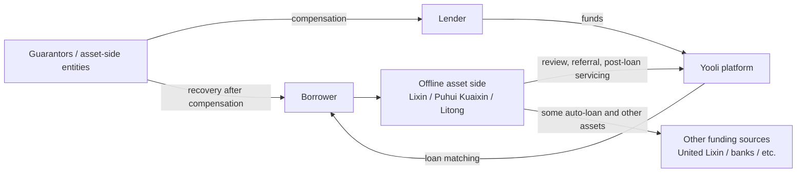

# Yooli Asset-Side Company Look-Through Investigation

> Updated: 2026-10-16  
> Chinese original: [`有利网资产端公司穿透调查.md`](../docs/有利网资产端公司穿透调查.md)  
> This article continues the look-through work begun in *Yooli Asset-Side and Related-Company Structure*. The focus is not company names, but the functional questions: **who actually sourced borrowers, who performed underwriting, who supplied funds, who guaranteed, who held collateral, who pursued recovery after default, and whether those entities still exist today.**
>
> **Evidentiary boundary:** corporate-registration information, court judgments, company/recruitment materials, and statements by parties in media interviews are kept separate. Media descriptions of an “acquisition,” or a former manager’s claim of “nominee shareholding,” are not treated as established equity-control facts unless supported by corporate files, equity agreements, or judicial findings.
>
> This English version is a translation for research use. If wording differs, the Chinese original controls.

## 1. The asset side was not a simple structure of wholly owned subsidiaries

Further investigation suggests that Yooli’s historical asset-side ecosystem can be divided into at least three groups:

1. **factoring, asset-management, and technology companies directly invested in by the platform**, such as Shenzhen Yooli Puhui Commercial Factoring, Shenzhen Honghe Boji Commercial Factoring, and Shenzhen Yooli Puhui Asset Management;
2. **offline institutions that actually originated loans at scale**, with the clearest evidence currently involving Shenzhen Lixin Kuaijie, Shenzhen Puhui Kuaixin, and Beijing Litong Automobile;
3. **financial or quasi-financial institutions that funded the asset side or took assignment of claims**, such as Shenzhen United Lixin Financial Leasing Co., Ltd., Wuhan Zhongbang Bank, and various guarantee companies.

Accordingly, “Yooli’s asset side” should not be equated simply with the companies directly controlled by Beijing Honghe Boji Financial Information Service Co., Ltd. on a corporate-chart website. The real operating chain looked more like this:

The same offline acquisition and risk-control network could therefore route assets to Yooli, but also to banks, financial-leasing companies, or other funding sources.

---

## 2. Shenzhen Lixin Kuaijie: small unsecured-credit asset originator that later developed its own leasing chain

### 2.1 Yooli publicly said it had completed an acquisition of Lixin

In a 2016 media interview with Wu Yiran, Yooli said it had completed acquisition procedures for two asset-side institutions: Shenzhen Lixin Kuaijie, focused on small loans, and Shenzhen Puhui Kuaixin, focused on consumer installments. Wu described the move as part of Yooli’s transition from a light-asset platform toward a heavier “credit factory” model.

Source:

- Sina Finance, *Yooli Recently Acquires Several Asset-Side Institutions, Aiming to Build a “Credit Factory”*  
  https://finance.sina.com.cn/roll/2016-01-30/doc-ifxnzanh0361192.shtml

Public corporate records from the same period did not show Yooli’s operating company directly holding Lixin shares. Whether the “acquisition” was implemented by direct equity, nominee holding, contractual control, or another method therefore remains uncertain.

### 2.2 Former Lixin CEO publicly said majority shareholder Dai Hongguang was “Yooli’s nominee holder”

A 2016 *China Business Journal* report quoted former Lixin CEO Ye Yanwei as saying that registered shareholder Dai Hongguang held 88% and Wu Xingbiao held 12%, with **Dai acting as “a nominee holder for the Yooli side”** and Wu representing Ye and the employee team.

This is a party statement in the media, not a judicial finding. It nevertheless provides a possible explanation for the combination of media claims that Yooli had completed an acquisition and public registration showing natural-person shareholders.

Source:

- Phoenix Tech republication of *China Business Journal*, *Competing for People and Assets: Yooli and Tuandai’s Year-End Battle*  
  https://tech.ifeng.com/a/20160110/41537083_0.shtml

### 2.3 Lixin was not merely a borrower-introduction intermediary; public cases show it directly originated and held loan claims

Public judicial materials show borrowers signing loan agreements directly with Shenzhen Lixin Kuaijie, with Lixin later suing and seeking enforcement as creditor. This is important: in at least part of its business, Lixin did not merely “refer borrowers to Yooli”; it created claims in its own name.

Current public corporate aggregators show:

- established: 2013-08-21;
- registered capital: RMB 50 million;
- paid-in capital: RMB 50 million;
- legal representative: Dai Hongguang;
- current shareholders: Dai Hongguang 88%, Wang Zengjun 12%;
- employees covered by social insurance in the 2024 annual report: 1;
- status: active.

Its website also remains accessible and states that it has service outlets in multiple cities.

Sources:

- Shuidi corporate information:  
  https://m.shuidi.cn/company-91d903740628dc92de62005c8976a284.html
- Lixin website:  
  https://www.lixin360.com/
- Lixin “About” page:  
  https://www.lixin360.com/website/about/about.html

### 2.4 Shenzhen’s local financial authority clarified in 2025 that Lixin is not a licensed local financial institution approved by that authority

In a 2025 public-response item, the Shenzhen local financial authority stated that Shenzhen Lixin Kuaijie Financial Services Co., Ltd. **was not a locally licensed financial institution established with that authority’s approval**. Its continued corporate existence therefore does not itself imply that it holds a local microloan or financing-guarantee license.

Source:

- Shenzhen local financial authority public response:  
  https://jr.sz.gov.cn/hdjlpt/detail?pid=3208406&via=pc

---

## 3. An important additional node: Shenzhen United Lixin Financial Leasing Co., Ltd.

This company could previously be mistaken for an unrelated external funding source, but court judgments directly connect it to Lixin Kuaijie.

### 3.1 United Lixin was established with Lixin Kuaijie as a founding party

Beijing Financial Court judgment **(2022) Jing 74 Min Zhong No. 1780** records that Shenzhen’s economic and trade authority approved, under Shen Jing Mao Xin Xi Zi [2015] No. 108, the joint establishment in Shenzhen of **Shenzhen United Lixin Financial Leasing Co., Ltd.** by:

- **Shenzhen Lixin Kuaijie Financial Services Co., Ltd.**;
- **Hong Kong-registered Huafutong Trading Co., Ltd.**

The judgment also confirms that United Lixin had qualifications for financial-leasing business, with a scope including financial leasing, leasing, acquisition of leased assets, residual-value handling and repair, leasing consultation, and guarantees.

Source:

- Beijing Financial Court, (2022) Jing 74 Min Zhong No. 1780:  
  [《北京金融法院（2022）京74民终1780号民事判决书》](https://zh.wikisource.org/wiki/北京金融法院（2022）京74民终1780号民事判决书)

### 3.2 United Lixin and Lixin Kuaijie share the same core legal representative, Dai Hongguang

Public judgments identify **Dai Hongguang** as legal representative of United Lixin; Lixin Kuaijie currently lists Dai as legal representative, executive director, and general manager.

At minimum, this establishes that the chain **Lixin asset side → United Lixin financial-leasing funding side** involved direct formation and personnel-control relationships and was not a connection between wholly unrelated parties.

### 3.3 Litong Auto Loans referred large numbers of customers to United Lixin

Numerous auto financial-leasing cases arising from 2017–2018 show a highly consistent structure:

1. the borrower/financing customer first signed a financing-services agreement with Beijing Litong Automobile Consulting Service Co., Ltd. or a local branch;
2. Litong verified information, performed credit review, designed the financing plan, installed GPS, handled security interests, and performed post-loan servicing and collections;
3. Litong referred the customer to United Lixin;
4. United Lixin provided funds through a vehicle sale-and-leaseback structure;
5. United Lixin or a branch obtained vehicle security or rights in the leased asset;
6. after default, United Lixin continued to sue for rent and claim priority against mortgaged vehicles.

Haidian District Court cases including **(2022) Jing 0108 Min Chu No. 5231** and **No. 5151** reconstruct this structure in detail.

Examples:

- [《北京市海淀区人民法院（2022）京0108民初5231号民事判决书》](https://zh.wikisource.org/wiki/北京市海淀区人民法院（2022）京0108民初5231号民事判决书)
- [《北京市海淀区人民法院（2022）京0108民初5151号民事判决书》](https://zh.wikisource.org/wiki/北京市海淀区人民法院（2022）京0108民初5151号民事判决书)

### 3.4 United Lixin was still litigating to recover historical auto-loan assets in 2026

A Beijing Financial Court hearing notice shows that on **2026-06-01** the court was still hearing a financial-leasing contract dispute involving Shenzhen United Lixin Financial Leasing Co., Ltd. and Bai Donghui.

This means United Lixin did not disappear early like many Yooli directly invested subsidiaries; at least through 2026, it continued using litigation to deal with historical financial-leasing claims.

Source:

- Beijing Financial Court, (2026) Jing 74 Min Zhong No. 379 hearing notice:  
  https://bjfc.bjcourt.gov.cn/ktgg/1707.html

### 3.5 United Lixin is now listed as a “legacy abnormal-operation financial-leasing enterprise” in Shenzhen

A 2026 regulatory-dynamics list published by the Shenzhen financial-leasing industry association included Shenzhen United Lixin Financial Leasing Co., Ltd., unified social credit code **91440300329543617N**, among “legacy abnormal-operation financial-leasing enterprises.”

The more accurate current description is therefore: **United Lixin still has historical claims and litigation activity, but there are clear problems with its normal ongoing financial-leasing operating status.**

Source:

- Shenzhen Financial Leasing Industry Association regulatory update:  
  https://www.szfla.org/Item/Show.asp?d=6496&m=1

---

## 4. Beijing Litong Automobile: not mere lead generation, but a full auto-loan asset-servicing and guarantee node

### 4.1 Historical recruitment materials directly described it as a “Yooli subsidiary”

Historical recruitment material for Beijing Litong Automobile Consulting Service Co., Ltd., also called “Litong Auto Loans,” described it as a **Yooli subsidiary** primarily engaged in vehicle-secured lending, with branches in numerous cities.

Source:

- historical Job5156 employer page:  
  https://www.job5156.com/comp/tstsQu7n6nQ7Kjzfk0Mz5w

This is evidence of strong business-brand and organizational affiliation, but a recruitment page alone cannot establish a precise equity relationship.

### 4.2 Litong routed similar auto-loan customers to different funding sources

A 2023 Guangzhou Intermediate Court case shows one customer receiving:

- RMB 116,000 of financing from Wuhan Zhongbang Bank;
- another RMB 23,200 financing transaction through Yooli, funded by lenders;
- with Litong providing consulting and services for both transactions.

In the Yooli transaction, the five-party agreement involved the borrower, lenders, Litong, Shenzhen Guoyin Shengda Financing Guarantee Co., Ltd., and Beijing Honghe Boji Financial Information Service Co., Ltd. Litong participated as both a **guarantor and service provider**.

Source:

- Guangzhou Intermediate People’s Court, (2023) Yue 01 Min Zhong No. 8824:  
  [《广东省广州市中级人民法院（2023）粤01民终8824号民事判决书》](https://zh.wikisource.org/wiki/广东省广州市中级人民法院（2023）粤01民终8824号民事判决书)

This shows that Litong’s offline risk-control, security, and post-loan system was not exclusive to Yooli. It functioned as an “asset production platform” capable of routing similar assets to multiple funding sources.

### 4.3 Litong itself assumed guarantee liability and, after compensation, obtained recovery claims and vehicle security

Chaoyang District Court **(2022) Jing 0105 Min Chu No. 40932** shows that:

- the borrower provided a vehicle to Litong as counter-security;
- Litong provided joint and several guarantee for the borrower’s debt to lenders;
- after default, Litong actually compensated the lenders;
- after compensation, Litong obtained a recovery claim against the borrower;
- the court recognized Litong’s corresponding priority right against the mortgaged vehicle.

Litong therefore could accumulate two types of assets with real economic value in some auto loans:

- **recovery claims created after compensation**;
- **vehicle security interests.**

Source:

- Beijing Chaoyang District People’s Court, (2022) Jing 0105 Min Chu No. 40932:  
  [《北京市朝阳区人民法院（2022）京0105民初40932号民事判决书》](https://zh.wikisource.org/wiki/北京市朝阳区人民法院（2022）京0105民初40932号民事判决书)

### 4.4 Public corporate aggregators currently show Litong as still active

Public enterprise-search results show Beijing Litong Automobile Consulting Service Co., Ltd. was established on 2014-11-27, has registered capital of RMB 27 million, lists Wang Jinghe as legal representative, and remains active.

Source:

- Qichacha index:  
  https://top.qcc.com/tc/aa898344871b.html

Current public materials are not reliable enough to establish its present shareholder structure, so no further ownership conclusion is drawn here.

---

## 5. Shenzhen Puhui Kuaixin: a 3C consumer-installment asset originator and its 2020 capital reduction

Public reporting in 2016 described Puhui Kuaixin as focusing on **3C consumer installments** with relatively small ticket sizes, and Yooli described it as one of two asset-side companies whose acquisition had been completed.

On 2020-04-03, *New Express Daily* published a capital-reduction notice under which Puhui Kuaixin proposed reducing registered capital from **RMB 100 million to RMB 30 million**, asked creditors to complete relevant procedures within 45 days, and stated that the company would remain responsible for debts within the original registered-capital amount while shareholders would bear joint liability.

Sources:

- 2016 asset-side reporting:  
  https://tech.ifeng.com/a/20160110/41537083_0.shtml
- 2020-04-03 capital-reduction notice:  
  https://ep.ycwb.com/epaper/xkb/html/2020-04/03/content_318_251489.htm

The timing is close to Yooli’s public risk exposure in mid-2020. Current public evidence does not prove a direct causal relationship between the reduction and Yooli’s wind-down and does not establish asset transfer.

---

## 6. After this look-through, asset-side investigative priorities should be reordered

Earlier work, based mainly on direct equity investments by Yooli’s operating company, treated several factoring and asset-management companies as the highest-priority targets. Court-case research suggests that the priority should be adjusted.

### First priority: Lixin Kuaijie and its downstream system

Reasons:

- Yooli publicly said it had completed an acquisition of Lixin;
- former Lixin CEO publicly said Dai Hongguang was “a nominee holder for the Yooli side”;
- Lixin itself directly created large numbers of loan claims;
- Lixin participated in establishing United Lixin Financial Leasing;
- United Lixin was still judicially recovering historical assets in 2026.

A relatively complete chain is now visible:

> **Lixin Kuaijie → United Lixin Financial Leasing → remaining vehicle-financing claims / security interests → later judicial recovery**

### Second priority: Beijing Litong Automobile

Reasons:

- historical materials explicitly described it as “under Yooli”;
- many court decisions reconstruct its actual role;
- it performed not only lead generation but review, servicing, guarantees, compensation, and vehicle-security functions;
- some historical claims became Litong’s own recovery claims after compensation.

### Third priority: Puhui Kuaixin

It is confirmed as a core consumer-installment asset-side institution, but its later ownership changes and the status of assets and claims after the 2020 capital reduction remain unclear.

### Fourth priority: factoring / asset-management companies directly controlled by the Yooli operating entity

The public business and litigation footprint of these companies is currently weaker than for Lixin, Litong, and United Lixin. Without liquidation reports, financial-statement notes, or links to specific claims, further searching based only on company names has relatively low marginal value.

---

## 7. New questions that matter for the Yooli wind-down

After this look-through, the investigation is no longer just about whether these were “related companies.” The more important questions are:

1. **Of the approximately RMB 8 billion outstanding balance described in Yooli’s 2021 announcement, how much came from Lixin, Puhui Kuaixin, Litong, and other asset-side channels?**
2. **After Yooli stopped making payments to lenders, did asset-side companies continue collecting and litigating against borrowers?**
3. **Where an asset-side guarantor compensated, had the original lender’s claim legally transferred to the guarantor/asset-side entity, and how was Yooli’s wind-down balance reduced correspondingly?**
4. **Do historical claims that United Lixin, Litong, and other entities can still collect today overlap with assets counted in Yooli’s wind-down?**
5. **What legal form did the reported 2015–2016 “acquisitions” of Lixin and Puhui Kuaixin actually take—equity, nominee holding, contractual/VIE control, or business acquisition?**
6. **When and why did these asset-side institutions switch funding from Yooli lenders to banks, financial-leasing companies, or other funding sources?**

Questions 2–4 are particularly valuable. If specific claim-level matches can be found, they would directly bear on whether assets continued to be recovered externally during the wind-down without being fully visible in platform-level disclosures.

---

## 8. Current conclusion

The evidence now supports a firmer statement than before:

> **Yooli’s real asset side was not merely a handful of factoring/asset-management shell companies visible in the operating company’s equity chart. It was a credit network that at one time had large-scale offline borrower acquisition, underwriting, guarantees, collateral, collections, and funding capabilities.**

Within that network:

- **Lixin Kuaijie** was an important source of small unsecured-credit assets;
- **Puhui Kuaixin** was an important source of 3C consumer-installment assets;
- **Litong Automobile** was an auto-loan origination, servicing, guarantee, and post-loan node;
- **United Lixin Financial Leasing** had a confirmed formation relationship with Lixin and became an important funding source and claim holder for Litong auto loans.

Current public evidence still does **not** prove that:

- claims these companies hold today are the same claims corresponding to Yooli lenders;
- Wu Yiran or Ren Yong transferred Yooli assets through these companies;
- judicial recoveries by these companies should legally be paid directly into Yooli’s wind-down.

The most valuable next step is to **trace the same borrower / same contract across Yooli → asset-side entity → guarantor → United Lixin or bank → later litigation**, rather than continuing to look only at corporate names.