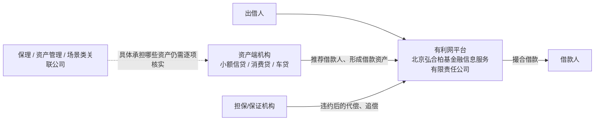

# 有利网资产端与关联公司结构梳理

> 更新日期：2026-10-16  
> 本文用于补充此前文档中较少涉及的“资产端”部分：有利网的借款资产从哪里来、哪些公司曾经承担资产获取/管理/保理/场景服务，以及这些公司与平台运营主体之间是什么关系。
>
> **重要说明：**本文把“工商关系已经确认”“公开报道或裁判文书能够确认”“仅根据公司名称或业务背景推测”严格分开。公司属于有利网体系，并不自动证明其承载过某一批具体债权；公司名称含“保理”“资产管理”，也不能直接推出其实际持有了有利网出借人的底层债权。

## 一、先理解有利网的资产端是什么

有利网早期并不是自己完成全部借款人开发和线下信贷流程，而是典型的线上平台与线下资产机构合作模式。

2015 年第一财经在报道有利网战略调整时提到，有利网成立初期由不同创始人分别负责资源、线上流量和线下资产；吴逸然长期负责资产端。随着业务扩大，有利网开始认为单纯依赖外部合作机构会削弱对资产质量的控制，因此计划从“纯平台”向资产端延伸，重点覆盖 **车贷、小额信贷、消费贷款**，并通过“有利普惠”“有利投资”“有利资本”等业务条线形成“平台 + 垂直资产端”的体系。

到 2016 年，多家媒体又报道有利网正在收购、整合线下资产端机构，并将目标描述为建立“信贷工厂”。公开报道中，有利网当时的消费金融资产主要覆盖 3C、手机、电动车等小额消费场景，同时向旅游、美容等消费领域扩展。

因此，在分析有利网后期风险时，不能只看 `yooli.com` 这一个网站运营主体。至少从公开材料看，平台背后长期存在一套更复杂的资产获取、借款人推荐、担保/代偿、催收和资产管理体系。

## 二、整体结构

可以先把有利网体系粗略拆成四层：

这里最重要的区别是：

- **平台运营主体**负责网站、合同撮合、出借人端服务和部分贷后管理；
- **资产端机构**负责寻找借款人、审核、线下服务和不同类型的信贷资产生产；
- **担保/保证机构**在部分产品中承担代偿义务；
- **保理、资产管理及场景公司**可能参与资产形成或管理，但每家公司的具体功能必须分别核实，不能只凭名称下结论。

## 三、当前工商关系图中的主要公司

根据 2026 年 10 月核验的企查查企业关系图，北京弘合柏基金融信息服务有限责任公司由北京弘合柏基科技有限责任公司 100% 持股，同时历史上曾直接投资多家保理、资产管理、科技及地方公司。

| 公司 | 与平台运营主体的关系 | 图中认缴/注册信息 | 目前能够确认或合理判断的作用 | 状态/备注 |
| --- | --- | ---: | --- | --- |
| **北京弘合柏基金融信息服务有限责任公司** | 核心运营主体 | 注册资本 10 亿元，公开披露实缴 5000 万元 | 有利网网站运营、网络借贷撮合、出借人服务及合同主体之一 | 存续 |
| **北京弘合柏基科技有限责任公司** | 2019 年后 100% 股东 | 注册资本 5 亿元，工商页面显示实缴 5 亿元 | 上层持股公司，不属于资产端本身；吴逸然、任用仍在该层持股 | 存续 |
| **南京弘合柏基金融信息服务有限责任公司** | 100% 投资 | 100 万元 | 与有利网早期南京主体和历史运营关系有关，具体历史功能需结合早期协议继续核对 | 已注销 |
| **深圳有利普惠商业保理有限公司** | 100% 投资 | 5000 万元 | 商业保理主体；名称和集团战略均指向资产端，但尚无公开证据证明其具体承载哪批有利网债权 | 已注销 |
| **深圳弘合柏基商业保理有限公司** | 100% 投资 | 5000 万元 | 商业保理主体；2020 年 4 月已进入清算程序 | 已注销 |
| **深圳有利普惠资产管理有限公司** | 100% 投资 | 5000 万元 | 资产管理主体；具体管理何种资产、是否持有底层债权，目前公开资料不足 | 已注销 |
| **北京房利宝资产管理有限公司** | 100% 投资 | 1000 万元 | 从名称看与房产/居住类资产有关，但具体业务尚未查实 | 已注销 |
| **普惠利居装饰咨询服务（北京）有限公司** | 100% 投资 | 1000 万元 | 名称可能对应居住、装修等消费场景，但目前只能作为待核实线索，不能直接认定其经营“装修贷” | 已注销 |
| **北京弘合柏基数字科技有限公司** | 100% 投资 | 1000 万元 | 更可能承担技术、数据或系统业务；目前未发现其直接承载信贷资产的公开证据 | 已注销 |
| **弘合柏基信息科技有限公司** | 100% 投资 | 5000 万元 | 公开资料较少，实际业务尚不清楚 | 关系图中未标注注销 |
| **合肥分公司、四川分公司** | 分支机构 | — | 地方业务网点或运营机构，是否承担过资产端职能需另行核实 | 均已注销 |

这张表目前只能说明**公司结构和可能的业务分工**。其中最需要避免的误区是：不能看到“商业保理”“资产管理”就直接把平台后来剩余债权认定为这些公司的资产。

## 四、历史上可以确认的资产端机构

### 1. 深圳利信快捷金融服务有限公司、深圳普惠快信金融服务有限公司

2015—2016 年的多篇公开报道都把这两家公司放在有利网的核心资产端位置。

2016 年有关资产端团队变动的报道中，利信被描述为以小额信贷为主，普惠快信被描述为分期付款/消费金融机构。媒体对于两家公司当时究竟属于“合作机构”“收购整合对象”还是已经形成更深层控制关系，表述并不完全一致，因此本文不直接把二者列为已经确认的有利网全资子公司。

不过，后来的裁判文书能够确认 **普惠快信确实直接参与有利网借款资产形成**：借款客户经普惠快信审核、推荐后在有利网平台向出借人借款，另有担保公司承担连带保证责任。这说明“线下资产机构 → 推荐借款人 → 有利网平台撮合 → 担保机构代偿”的业务链条并非媒体推测，而是在真实合同和诉讼中出现过。

### 2. 北京利通汽车咨询服务有限公司（利通车贷）

公开招聘资料曾直接把北京利通汽车咨询服务有限公司称为“有利网旗下子公司”，并称其主要经营汽车抵押贷款。

更重要的是，后来的法院判决可以确认其实际业务关系：借款人先与利通公司签订借款咨询及服务协议，由利通公司将借款客户推荐至有利网；在有利网形成的借款协议中，利通公司作为服务方参与，并在部分交易中承担保证或贷后服务职责，车辆则作为相关融资安排中的担保或反担保资产。

因此，**车贷是有利网资产端中证据最清楚的一条业务线之一。**

## 五、从“合作资产端”到“自营/控制资产端”的变化

目前公开资料显示，有利网的资产端至少经历了以下变化：

### 第一阶段：平台 + 外部线下机构

早期有利网主要发挥互联网平台和资金端优势，借款客户更多由外部小贷、担保或线下信贷机构开发。2014 年的行业报告甚至把有利网作为典型 O2O/通道型平台案例：平台负责线上运营和投资人获取，线下机构负责开发借款人。

### 第二阶段：消费金融快速扩大

从 2014 年开始，有利网显著提高消费金融占比。2016 年公开报道援引有利网数据称，2014 年 8 月消费金融业务占比已超过 40%，到 2015 年下半年超过 90%。其借款规模以小额个人消费为主。

### 第三阶段：收购、参股和自建资产端

2015 年以后，吴逸然公开强调要加强对资产端的控制。有利网开始通过收购、参股、控股、自建团队等方式进入车贷、小额信用贷和消费金融业务，同时注册和设立多家“有利普惠”、保理、资产管理等公司。

这一步非常重要，因为它意味着后期有利网已经不能简单理解为一个完全独立于资产生产方的纯信息中介平台。

但是，**“加强控制”与“平台和所有借款人属于同一公司体系”不是一回事。**有些资产机构是关联公司，有些可能只是深度合作机构，还有些存在收购/控制关系但公开工商链条并不完整，需要逐一核实。

### 补充：后续材料显示，外部合作与自建/整合资产端长期并存

后续取得的上市公司公告、重大资产重组文件和裁判文书，把这一结构补得更完整：有利网并不是从“外部合作”简单切换成“全部自营”，而是形成了**外部资产合作 + 深度整合/自建资产端并存**的模式。

目前已经可以较明确区分出两类：

- **外部合作资产渠道**：通盛小贷、和创未来/优分期、赫美小贷/赫美智科等。公开合同、上市公司材料能够量化部分合作额度、保证责任和存量余额；
- **与有利网关系更深的资产生产体系**：利信快捷、普惠快信、利通车贷等。媒体曾报道收购、整合或“旗下”关系，裁判文书又能确认这些机构实际承担获客、审核、推荐、贷后、担保或催收等职能。

这两类材料应同时使用。外部合作渠道的存在说明不能把全部资产端都描述成平台自营；而利信、普惠快信、利通等更深层业务关系又说明，有利网后期也不能简单描述成与资产生产完全隔离的纯撮合中介。

更完整的证据边界见：

- [有利网自建资产端证据链与证据边界](./有利网自建资产端证据链与证据边界.md)
- [有利网早期外部资产合作机构与担保网络](./有利网早期外部资产合作机构与担保网络.md)

## 六、目前最值得继续调查的四家公司

基于现有公司结构和业务性质，后续最值得优先穿透的不是科技公司和地方分公司，而是以下四个主体：

### 1. 深圳有利普惠商业保理有限公司

需要确认：

- 实际经营期间承接过哪些保理资产；
- 是否与有利网借款项目存在直接对应关系；
- 注销前是否仍有应收账款或债权；
- 清算资产最终如何处置。

### 2. 深圳弘合柏基商业保理有限公司

这家公司尤其值得关注，因为其清算时间为 **2020 年 4 月**，距离有利网 2020 年中停止新增业务和兑付危机公开化很近。

目前只能确认其进入过清算程序，**没有证据证明存在异常资产转移**。真正有价值的材料是注销/清算档案中的资产、债权、负债和剩余财产分配情况。

### 3. 深圳有利普惠资产管理有限公司

名称直接指向资产管理，但目前缺少公开材料说明其究竟管理的是平台自身资产、合作机构资产，还是其他业务资产。

需要继续查明其注销前的资产负债和与运营主体之间的往来。

### 4. 北京房利宝资产管理有限公司

需要确认它是否对应房产抵押、房贷或居住场景业务，以及是否曾经持有或管理有利网体系中的相关资产。

## 七、这部分调查与清退问题有什么关系

把资产端公司弄清楚，不是为了单纯画一张更复杂的公司关系图，而是为了回答几个与后期清退直接相关的问题：

1. **平台后来形成的大量坏账，最初是谁开发和审核的？**
2. **资产端公司在借款人违约后承担什么责任：催收、代偿、回购，还是只负责推荐？**
3. **有利网收购或控制资产端后，平台与借款资产之间的风险隔离是否发生了变化？**
4. **保理、资产管理等公司注销时，手里是否仍然存在应收款、债权或其他可清收资产？**
5. **清退期间所谓“第三方 AMC”“债权转让”“债权认领”与此前这些资产端主体之间是否存在承接关系？**

这些问题目前绝大多数还没有公开证据能够回答，因此本文只是建立调查框架，不预设结论。

## 八、当前可以下的结论和不能下的结论

### 可以确认

- 有利网并非始终只是一个完全依靠外部机构的纯线上平台；2015 年以后明确向资产端延伸。
- 车贷、小额信贷、消费金融是其主要资产方向。
- 利信快捷、普惠快信等机构确实曾为有利网提供借款资产来源。
- 普惠快信、利通车贷与有利网之间的借款人推荐和合同关系，可以从裁判文书得到验证。
- 有利网运营主体历史上直接投资过多家商业保理、资产管理和科技公司，其中多家公司后来注销。

### 目前不能确认

- 不能仅凭公司关系图认定这些子公司就是平台全部底层债权的实际持有人。
- 不能仅凭注销时间认定存在资产转移或逃废债。
- 不能仅凭“收购资产端”的媒体表述认定利信、普惠快信在所有时期都属于有利网股权控制公司。
- 目前没有公开证据证明吴逸然、任用通过这些公司转移了有利网资产。
- 对保理和资产管理公司的真正判断，仍然需要清算报告、财务明细、关联方往来和具体债权台账。

## 九、主要公开来源

1. 第一财经：《有利网变局背后：中国式P2P的集体阵痛》  
   https://www.yicai.com/news/4683714.html

2. 华夏时报/新浪财经：《近日收购数家资产端机构 有利网志于“信贷工厂”》  
   https://finance.sina.com.cn/roll/2016-01-30/doc-ifxnzanh0361192.shtml

3. 经济观察网：《吴逸然：资产端收购整合完毕 建设消费金融信贷工厂》  
   https://www.eeo.com.cn/2016/0109/282371.shtml

4. 界面/新浪财经：《有利网2000人出走 与团贷网开打资产端争夺战》  
   https://finance.sina.com.cn/money/bank/p2p/2016-01-01/doc-ifxneept3504857.shtml

5. 中国经营报/凤凰科技：《“抢”人“抢”资产 有利网团贷网跨年肉搏》  
   https://tech.ifeng.com/a/20160110/41537083_0.shtml

6. 广州市中级人民法院相关裁判文书（北京利通汽车咨询服务有限公司与有利网借款关系）  
   [《广东省广州市中级人民法院（2023）粤01民终8824号民事判决书》](https://zh.wikisource.org/wiki/广东省广州市中级人民法院（2023）粤01民终8824号民事判决书)

7. 普惠快信借款推荐、担保代偿相关裁判文书  
   [《陈昌和、深圳市诚信祥融资担保有限公司追偿权纠纷民事二审民事判决书》（2020）琼96民终2868号](https://zh.wikisource.org/wiki/陈昌和、深圳市诚信祥融资担保有限公司追偿权纠纷民事二审民事判决书)

8. 深圳弘合柏基商业保理有限公司清算公告，2020-04-24  
   https://ep.ycwb.com/epaper/xkb/h5/html5/2020-04/24/content_321_259134.htm

9. 企业关系与投资结构：企查查工商关系图（2026-10-16 核验）。

---

本文后续应重点补充：各资产端公司的成立/注销时间线、股东变更、清算报告、对外诉讼和具体借款产品对应关系。只有把这些公司与底层债权逐步对应起来，才能进一步判断有利网风险究竟发生在哪一层、清退阶段还存在哪些可能被忽略的责任或资产。
