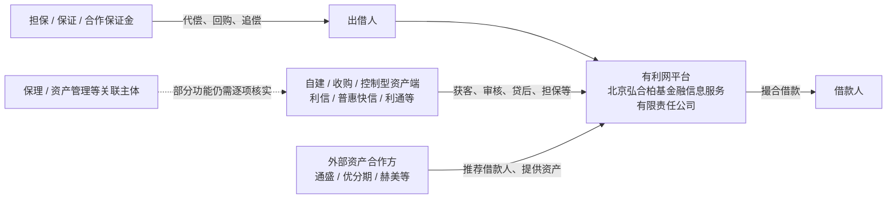

# 有利网资产端与关联公司结构梳理

> 更新日期：2026-10-16  
> 本文梳理有利网历史上的资产来源、平台直接投资公司、核心线下资产机构和外部合作渠道，并回答一个已经可以较明确下结论的问题：**有利网后来是否形成了自己的资产端能力。**
>
> **结论先行：可以。** 现有公开采访、媒体报道、工商资料和裁判文书已经足以证明，有利网早期主要依赖外部资产合作机构，但自 2015 年以后明确从“纯平台”向资产端纵向延伸，通过收购、整合、自建团队和深度控制型合作形成了自己的资产生产、审核、贷后、抵押、担保和催收能力。后期更准确的结构是“自建/控制型资产端 + 外部合作资产端”并行，而不是纯第三方供给。
>
> 但“自建资产端”不等于“全部资产自营”，更不等于已经证明“自融”。本文仍严格区分业务控制、股权控制和资金最终用途。

---

## 一、先把“资产端”定义清楚

P2P 平台的“资产端”不是简单指某一家持有债权的公司，而是整个借款资产生产链，包括：

- 借款人获客；
- 信用审核；
- 场景和商品服务；
- 借款资料整理和推荐；
- 风险定价；
- 抵押和反担保办理；
- 贷后管理；
- 催收；
- 担保、代偿和追偿。

因此，判断有利网有没有“自建资产端”，不能只看北京弘合柏基金融信息服务有限责任公司的直接股东或全资子公司名单，还必须看谁实际上在完成上述工作。

---

## 二、总体结构：有利网后期是混合资产模式

结合现有材料，可以把后期业务结构概括为：



这里最重要的是：

> **有利网既不是始终完全靠外部小贷公司提供资产，也不是所有资产都来自平台自己控制的体系。它经历了从“平台 + 外部资产方”向“平台 + 自有/控制型资产生产能力 + 外部资产渠道并存”的变化。**

---

## 三、第一阶段：早期主要依赖外部线下资产机构

有利网早期的典型结构是 O2O / 通道型合作：

- 有利网负责网站、出借人开发、线上撮合；
- 小贷、担保或其他线下机构负责开发借款客户、审核和贷后；
- 担保机构或资产合作方对借款提供增信和代偿。

重庆通盛小贷相关裁判文书就是最清楚的样本之一：2014 年《众筹互联网金融项目合作协议》明确规定，有利网负责开发和管理出借人、撮合借贷，通盛小贷负责开发、审批、回收和管理借款客户，同时承担连带保证责任。

这说明有利网最初确实符合“平台资金端 + 外部资产端”的典型模式。

专题：

- [有利网早期外部资产合作机构与担保网络](./有利网早期外部资产合作机构与担保网络.md)

---

## 四、2015 年以后：有利网明确宣布向资产端纵向延伸

2015 年第一财经关于有利网战略调整的报道提到：

- 公司成立初期不同创始人分别负责资源、线上流量和线下资产；
- 吴逸然长期负责资产端；
- 随着业务扩大，有利网认为纯粹依赖合作机构会削弱对资产质量的控制；
- 因而提出“从过去的纯平台往资产端布局”；
- 重点进入车贷、小额信贷、消费贷款等领域。

来源：

- 第一财经：《有利网变局背后：中国式P2P的集体阵痛》  
  https://www.yicai.com/news/4683714.html

2015 年末至 2016 年初，多篇报道进一步提到有利网完成对若干资产机构的收购/整合，并提出建设消费金融“信贷工厂”。

来源：

- 华夏时报/新浪财经：《近日收购数家资产端机构 有利网志于“信贷工厂”》  
  https://finance.sina.com.cn/roll/2016-01-30/doc-ifxnzanh0361192.shtml
- 经济观察网：《吴逸然：资产端收购整合完毕 建设消费金融信贷工厂》  
  https://www.eeo.com.cn/2016/0109/282371.shtml

因此，“向资产端延伸”不是后来根据公司名称做出的推测，而是有利网管理层公开说明过的发展战略。

---

## 五、平台直接投资的资产相关公司

根据 2026 年 10 月核验的工商关系，北京弘合柏基金融信息服务有限责任公司历史上曾直接投资多家保理、资管、科技及场景类公司。

| 公司 | 与运营主体关系 | 目前能确认的性质 | 证据边界 |
| --- | --- | --- | --- |
| **深圳有利普惠商业保理有限公司** | 直接投资 | 商业保理主体 | 尚未穿透到具体有利网底标 |
| **深圳弘合柏基商业保理有限公司** | 直接投资 | 商业保理主体；2020-04 进入清算 | 不能仅凭清算认定资产转移 |
| **深圳有利普惠资产管理有限公司** | 直接投资 | 资产管理主体 | 实际管理资产范围仍不清楚 |
| **北京房利宝资产管理有限公司** | 直接投资 | 资产管理/场景类主体 | 是否承载房产类底标尚未查实 |
| **普惠利居装饰咨询服务（北京）有限公司** | 直接投资 | 居住/装修场景相关名称 | 不能仅凭名称认定经营装修贷 |
| **北京弘合柏基数字科技有限公司** | 直接投资 | 技术/数据类主体 | 未发现直接承载信贷资产证据 |

这些公司本身不足以证明“平台把出借人债权装进了自己的子公司”，但它们和公开的“资产端纵向布局”战略放在一起，能够说明有利网确实主动建设了资产、保理和资管基础设施。

---

## 六、核心自建/控制型资产端之一：深圳利信快捷

### 1. 有利网公开称已经完成对利信的收购

2016 年媒体采访中，有利网方面明确表示完成对包括深圳利信快捷在内的资产方收购程序，并将其作为建设“信贷工厂”的重要组成部分。

利信主要从事小额信用贷等业务。

### 2. 工商表面股权与“收购”说法不完全一致

同期公开工商登记并没有简单显示北京弘合柏基直接持有利信股权。

利信前 CEO 叶衍伟曾公开称，工商大股东代红光为“有利网方面的代持人”。

来源：

- 中国经营报/凤凰科技：《“抢”人“抢”资产 有利网团贷网跨年肉搏》  
  https://tech.ifeng.com/a/20160110/41537083_0.shtml

这一说法能够解释公开报道与工商表面的差异，但仍属于当事人媒体陈述，不是司法确认。因此目前应表述为：

> **业务层面的收购/控制关系证据较强，但法律上的具体控制方式仍未完全穿透。**

### 3. 利信自身具备形成和持有贷款债权的能力

公开裁判材料显示，利信并非只做流量推荐，至少部分业务中会直接与借款人形成债权并自行诉讼、执行。

另外，利信参与设立了深圳市联合利信融资租赁有限公司。北京金融法院裁判文书确认，利信快捷与香港公司共同设立联合利信融资租赁。

这表明利信已经形成独立的信贷资产生产和融资链能力。

专题：

- [有利网资产端公司穿透调查](./有利网资产端公司穿透调查.md)

---

## 七、核心自建/控制型资产端之二：深圳普惠快信

普惠快信是目前司法证据最完整的消费金融资产端之一。

公开刑事判决引用了 2014 年 4 月 10 日弘合柏基与普惠快信的《战略合作协议书》。协议明确：

### 普惠快信负责

- 开发消费金融借款客户；
- 信用审核；
- 日常管理；
- 向有利网提供借款信息和资料；
- 协助办理借款手续。

### 有利网负责

- 开发、管理平台注册出借人；
- 提供信息服务；
- 撮合借贷；
- 接收借款客户还款并向出借人分配。

另有大量追偿案件反复出现：

```text
消费者 / 商品场景
      ↓
普惠快信获客、审核、推荐
      ↓
有利网匹配平台注册出借人
      ↓
诚信祥 / 国银盛达等担保
      ↓
逾期后代偿、追偿
```

因此可以确认：**普惠快信是实际生产有利网消费贷资产的核心机构，而不是普通广告渠道。**

2020-04-03，普惠快信还曾公告注册资本从 1 亿元减至 3000 万元。这一时间点值得记录，但不能据此认定存在资产转移。

---

## 八、核心自建/控制型资产端之三：北京利通汽车

利通车贷是目前证据最完整的车贷线。

历史招聘资料直接把北京利通汽车咨询服务有限公司描述为“有利网旗下子公司”。单独一条招聘资料不足以证明法律股权关系，但后续大量裁判文书能够证明其真实业务角色。

法院案件显示，利通实际负责：

- 客户获取；
- 信息核实和信用审核；
- 融资方案；
- GPS 安装；
- 抵押手续；
- 贷后管理；
- 催收；
- 在部分有利网借款中作为服务方和担保方；
- 代偿后取得追偿权和车辆抵押优先受偿权。

更重要的是，同一套利通资产生产体系还可以把客户接给武汉众邦银行、联合利信融资租赁等其他资金方。

这说明利通不是有利网网页中的一个形式性角色，而是一家实质性的车贷资产生产平台。

来源示例：

- 广东省广州市中级人民法院（2023）粤01民终8824号  
  https://zh.wikisource.org/wiki/广东省广州市中级人民法院（2023）粤01民终8824号民事判决书

---

## 九、外部资产合作方仍然长期存在

“有利网形成自建资产端”不等于“所有资产都来自自己体系”。

### 1. 通盛小贷

2014 年已经存在完整的“外部资产开发 + 担保 + 合作保证金 + 代偿后债权转移”模式。

### 2. 和创未来 / 优分期

上市公司重大资产重组法律意见书披露，有利网渠道授信额度 **3 亿元**；和创未来、安家世行及创始人个人共同提供保证。

### 3. 赫美小贷 / 赫美智科

上市公司公开文件披露合作规模 **5 亿元**。有利网渠道放款余额从 2018 年末到 2021 年中长期保持在约 0.92 亿元附近。

因此后期资产来源必须理解成混合结构：

> **部分资产来自有利网自建/收购/控制型信贷网络，部分资产仍来自独立外部机构。**

---

## 十、为什么“自建资产端”已经可以写成事实，而“自融”仍不能

### 可以写成事实的

现有材料已经足以支持：

- 有利网公开宣布向资产端延伸；
- 有利网公开称收购、整合部分资产机构；
- 核心资产机构真实参与获客、审核、贷后、担保和催收；
- 平台直接投资保理、资管等相关公司；
- 利信、普惠快信、利通等形成了实际的资产生产网络。

因此“有利网后来形成自建/控制型资产端能力”是一个有多来源交叉验证的经营事实。

### 仍不能写成事实的

“自融”要求证明：

> 出借人资金最终用于平台运营主体、股东、实控人或其控制企业自身融资需求。

这需要底标穿透和资金最终用途证据。

2018 年重点环节专项审计在其检查范围内还明确表示，未发现平台设立资金池、为自身或变相为自身融资等情形。

所以目前必须坚持：

> **自建资产端 ≠ 自融。**

自建资产端增加了关联交易、风控独立性和内部风险信息掌握程度等需要调查的问题，但不能直接替代资金用途证据。

---

## 十一、这与 2020 年风险为什么重要

确认有利网存在自建/控制型资产端后，2020 年风险不能只理解成“外部借款人突然违约，平台完全被动”。

因为平台长期深度参与：

- 借款来源；
- 审核；
- 资产定价；
- 贷后；
- 担保和代偿安排；
- 债权转让和风险处置。

这意味着平台内部理论上能够比普通出借人更早看到：

- 某一资产渠道逾期率上升；
- 担保方代偿开始延迟；
- 某一合作机构资金紧张；
- 债转买方持续不足；
- 某些类型贷款的回收率开始恶化。

所以现在真正应继续追的是：

> **有利网何时掌握到这些风险已经从可管理变成结构性恶化，又何时以足够清晰的方式向出借人披露。**

---

## 十二、当前结论

### 可以确认

- 有利网早期主要依赖外部资产合作；
- 2015 年以后明确向资产端纵向延伸；
- 利信、普惠快信、利通等确实构成了核心资产生产网络；
- 有利网直接投资过保理、资管等资产相关主体；
- 车贷、小额信用贷、消费金融是其主要资产方向；
- 同时仍存在通盛、优分期、赫美等真实外部资产渠道；
- 因此后期业务结构应定义为“自建/控制型资产端 + 外部合作资产端”的混合模式。

### 仍不能确认

- 不能认定所有底层借款都来自有利网控制公司；
- 不能认定利信、普惠快信在所有年份都通过相同法律形式受有利网股权控制；
- 不能仅凭自建资产端认定自融；
- 不能仅凭保理/资管公司名称认定其持有出借人底层债权；
- 不能仅凭公司注销、减资或清算认定存在资产转移。

更完整的论证见：

- [有利网自建资产端证据链与证据边界](./有利网自建资产端证据链与证据边界.md)
- [有利网资产端公司穿透调查](./有利网资产端公司穿透调查.md)
- [有利网早期外部资产合作机构与担保网络](./有利网早期外部资产合作机构与担保网络.md)

---

## 十三、后续穿透方向

资产端“有没有”已经不是主要问题。下一步最有价值的是：

1. 自建/控制型资产端与外部资产端分别贡献了多少存量和坏账；
2. 利信、普惠快信等法律控制形式的原始股权/代持/收购文件；
3. 各资产端在 2018—2020 年的实际逾期率、代偿率和回收率；
4. 平台本体 2018 年大额其他应收款、预付款与这些资产端之间是否存在往来；
5. 清退阶段这些资产端仍持有哪些追偿权、抵押权或应收资产；
6. 未完成代偿的出借人债权是否发生过对外出售，以及交易价格和回款归属。

只有继续向具体债权和资金流穿透，才能从“有利网拥有自己的资产端”进一步回答“风险和损失最终留在了谁那里”。
