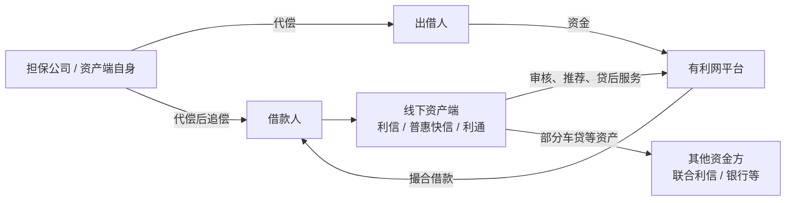

# 有利网资产端公司穿透调查

> 更新日期：2026-10-16  
> 本文是在《有利网资产端与关联公司结构梳理》的基础上继续向下穿透，重点不是“公司名字叫什么”，而是回答：**谁实际开发借款人、谁审核、谁出资、谁担保、谁持有抵押物、谁在违约后继续追偿，以及这些主体今天是否仍然存在。**
>
> **证据边界：**本文严格区分工商信息、法院判决、公司/招聘资料、媒体采访中的当事人陈述。媒体所称“收购”、前管理人员所称“代持”等内容，在没有工商档案、股权协议或司法认定前，不作为已经查实的股权控制事实。

## 一、目前看到的资产端并不是一套简单的“全资子公司”结构

进一步检索后，有利网历史资产端可以分成至少三类：

1. **平台直接投资的保理、资管、科技公司**：例如深圳有利普惠商业保理、深圳弘合柏基商业保理、深圳有利普惠资产管理等；
2. **真正大规模生产贷款资产的线下机构**：目前证据最清楚的是深圳利信快捷、深圳普惠快信、北京利通汽车；
3. **给资产端提供资金或承接债权的金融/类金融机构**：例如深圳市联合利信融资租赁有限公司、武汉众邦银行、部分担保公司等。

因此，“有利网资产端”不能简单等同于企查查关系图中北京弘合柏基金融信息服务有限责任公司直接控股的那些公司。真实业务链条更像是：

这意味着同一套线下获客和风控体系，可以把资产接给有利网，也可以接给银行、融资租赁公司等其他资金方。

---

## 二、深圳利信快捷：小额信用贷资产端，而且后来形成了自己的融资租赁链条

### 1. 有利网公开称已经完成对利信的收购

2016 年媒体采访吴逸然时，有利网方面明确表示，已经完成两家资产方的收购程序，其中深圳利信快捷主营小额贷款业务，深圳普惠快信主营消费分期业务。吴逸然还把这次动作解释为有利网从轻资产模式向“信贷工厂”重资产模式转变的一部分。

来源：

- 新浪财经：《近日收购数家资产端机构 有利网志于“信贷工厂”》  
  https://finance.sina.com.cn/roll/2016-01-30/doc-ifxnzanh0361192.shtml

但同一时期公开工商登记并没有显示有利网运营主体直接持股利信，因此“收购”究竟通过直接股权、代持、协议控制还是其他方式实现，仍需谨慎。

### 2. 利信前 CEO 曾公开称大股东代红光是“有利网方面的代持人”

2016 年《中国经营报》相关报道中，利信前 CEO 叶衍伟称，当时工商股东代红光持股 88%、吴行标持股 12%，其中**代红光为“有利网方面的代持人”**，吴行标则代表叶衍伟本人及员工团队。

这是当事人的媒体陈述，不是司法认定；但它与“媒体报道已完成收购、工商表面仍为自然人持股”之间形成了可以解释的线索。

来源：

- 凤凰科技转载《中国经营报》：《“抢”人“抢”资产 有利网团贷网跨年肉搏》  
  https://tech.ifeng.com/a/20160110/41537083_0.shtml

### 3. 利信不是单纯获客中介，公开案件显示它自己直接形成和持有借款债权

公开裁判材料中，可以看到借款人与深圳利信快捷直接签署借款合同，利信作为债权人起诉、申请执行。这一点很重要：至少在部分业务中，利信不是只把借款人“推荐给有利网”，而是自身形成债权。

截至目前公开工商聚合信息显示：

- 成立：2013-08-21；
- 注册资本：5000 万元；
- 实缴资本：5000 万元；
- 法定代表人：代红光；
- 当前股东：代红光 88%、王增俊 12%；
- 2024 年报参保人数：1 人；
- 状态：存续。

其官网目前仍可访问，并宣称在全国多地设有服务网点。

来源：

- 水滴信用企业信息：  
  https://m.shuidi.cn/company-91d903740628dc92de62005c8976a284.html
- 利信官网：  
  https://www.lixin360.com/
- 利信官网“关于利信”：  
  https://www.lixin360.com/website/about/about.html

### 4. 2025 年深圳地方金融管理部门明确：利信不属于当地审批设立的持牌地方金融机构

2025 年深圳市地方金融管理局在公开互动答复中称，深圳利信快捷金融服务有限公司**不属于该局审批设立的地方持牌金融机构**。这说明其目前仍然存续，并不意味着它本身具有小贷、融资担保等地方金融牌照。

来源：

- 深圳市地方金融管理局公开答复：  
  https://jr.sz.gov.cn/hdjlpt/detail?pid=3208406&via=pc

---

## 三、一个重要的新节点：深圳市联合利信融资租赁有限公司

这家公司此前容易被当成一个“外部资金方”，但法院判决已经把它和利信快捷直接连起来。

### 1. 联合利信是由利信快捷参与设立的

北京金融法院（2022）京74民终1780号判决记载，深圳市经济贸易和信息化委员会以深经贸信息资字〔2015〕108号批复，批准：

- **深圳利信快捷金融服务有限公司**；
- **香港注册的华富通贸易有限公司**；

共同在深圳设立中外合资企业 **深圳市联合利信融资租赁有限公司**。

判决同时确认联合利信具有融资租赁相关资质，经营范围包括融资租赁、租赁、购买租赁财产、残值处理维修、租赁交易咨询和担保等。

来源：

- 北京金融法院（2022）京74民终1780号：  
  [《北京金融法院（2022）京74民终1780号民事判决书》](https://zh.wikisource.org/wiki/北京金融法院（2022）京74民终1780号民事判决书)

### 2. 联合利信和利信快捷由同一个核心人物代红光担任法定代表人

公开裁判文书中，联合利信法定代表人为 **代红光**；利信快捷目前法定代表人、执行董事兼总经理也为代红光。

因此至少可以确认：**利信资产端 → 联合利信融资租赁资金端**并不是两个完全无关的主体，而存在明确的设立和人员控制关系。

### 3. 利通车贷把客户大量推荐给联合利信

大量 2017—2018 年形成的汽车融资租赁案件显示出高度一致的结构：

1. 借款/融资客户先与北京利通汽车咨询服务有限公司或其地方分公司签《融资服务协议》；
2. 利通负责信息核实、信用审核、融资方案、GPS 安装、抵押手续、贷后管理、催收；
3. 利通把客户推荐给联合利信；
4. 联合利信以车辆售后回租形式提供资金；
5. 联合利信或其分公司取得车辆抵押权或租赁物权利；
6. 客户违约后，联合利信继续在法院起诉追租金，并对抵押车辆主张优先受偿。

例如北京市海淀区法院（2022）京0108民初5231号、（2022）京0108民初5151号等案件都完整还原了这一结构。

来源示例：

- [《北京市海淀区人民法院（2022）京0108民初5231号民事判决书》](https://zh.wikisource.org/wiki/北京市海淀区人民法院（2022）京0108民初5231号民事判决书)
- [《北京市海淀区人民法院（2022）京0108民初5151号民事判决书》](https://zh.wikisource.org/wiki/北京市海淀区人民法院（2022）京0108民初5151号民事判决书)

### 4. 联合利信直到 2026 年仍在继续诉讼追收历史车贷资产

北京金融法院公告显示，**2026 年 6 月 1 日**仍在审理“深圳市联合利信融资租赁有限公司、白东辉融资租赁合同纠纷”。

这说明这家公司并没有像很多有利网直属子公司那样早早注销，它至少直到 2026 年仍在通过司法程序处理存量融资租赁债权。

来源：

- 北京金融法院（2026）京74民终379号开庭公告：  
  https://bjfc.bjcourt.gov.cn/ktgg/1707.html

### 5. 但联合利信目前已被列入深圳“存量非正常经营类融资租赁企业”名单

2026 年深圳市融资租赁行业协会公布的监管动态名单中，统一社会信用代码 **91440300329543617N** 的深圳市联合利信融资租赁有限公司被列入“存量非正常经营类融资租赁企业”。

因此目前更准确的描述是：**联合利信仍有历史债权和诉讼活动，但其正常融资租赁经营状态已经存在明显问题。**

来源：

- 深圳市融资租赁行业协会监管动态：  
  https://www.szfla.org/Item/Show.asp?d=6496&m=1

---

## 四、北京利通汽车：不是简单导流，而是完整的车贷资产服务和担保节点

### 1. 历史招聘资料直接称其为“有利网旗下子公司”

利通汽车早期招聘资料明确写道：北京利通汽车咨询服务有限公司“又名利通车贷”，是**有利网旗下子公司**，主要开展汽车抵押贷款业务，并在全国大量城市设立分公司。

来源：

- 智通直聘历史企业页：  
  https://www.job5156.com/comp/tstsQu7n6nQ7Kjzfk0Mz5w

这可以证明双方在业务品牌和组织层面存在高度关联，但不能单凭招聘页认定具体股权关系。

### 2. 利通曾把同一批车贷客户接给不同资金方

2023 年广州中院案件显示，同一名客户：

- 一笔 116000 元融资由武汉众邦银行提供；
- 另一笔 23200 元融资通过有利网平台，由出借人提供资金；
- 两笔业务都由利通提供咨询和服务。

在有利网那笔交易中，五方协议的主体包括借款人、出借方、利通、深圳市国银盛达融资担保有限公司和北京弘合柏基金融信息服务有限责任公司。利通同时作为**担保方、服务方**参与。

来源：

- 广东省广州市中级人民法院（2023）粤01民终8824号：  
  [《广东省广州市中级人民法院（2023）粤01民终8824号民事判决书》](https://zh.wikisource.org/wiki/广东省广州市中级人民法院（2023）粤01民终8824号民事判决书)

这说明利通的线下风控、抵押和贷后体系并非专属于有利网，而是一个能够把同类资产接给多个资金方的“资产生产平台”。

### 3. 利通自己承担保证责任，并在代偿后取得追偿权和车辆抵押权

朝阳法院（2022）京0105民初40932号案件显示：

- 借款人以车辆向利通提供反担保；
- 利通为借款人债务向出借人提供连带保证；
- 借款逾期后，利通实际向出借人进行代偿；
- 代偿后，利通取得对借款人的追偿权；
- 法院确认利通对抵押车辆享有相应优先受偿权。

因此，利通在部分车贷中确实可能沉淀两类具有现实价值的资产：

- **代偿后的追偿债权**；
- **车辆抵押权。**

来源：

- 北京市朝阳区人民法院（2022）京0105民初40932号：  
  [《北京市朝阳区人民法院（2022）京0105民初40932号民事判决书》](https://zh.wikisource.org/wiki/北京市朝阳区人民法院（2022）京0105民初40932号民事判决书)

### 4. 当前公开工商聚合信息显示利通仍然存续

公开企业搜索结果显示，北京利通汽车咨询服务有限公司成立于 2014-11-27，注册资本 2700 万元，法定代表人为王井和，目前显示存续。

来源：

- 企查查企业索引：  
  https://top.qcc.com/tc/aa898344871b.html

现阶段尚未找到足够可靠的公开材料确认其当前股东结构，因此暂不对股权归属作进一步结论。

---

## 五、深圳普惠快信：3C 消费分期资产端，以及 2020 年的减资动作

普惠快信在 2016 年公开报道中被明确描述为以 **3C 消费分期**为主要业务，单笔借款金额较小，并被有利网方面称为已经完成收购的两家资产方之一。

2020 年 4 月 3 日，《新快报》刊登其减资公告：公司拟将注册资本从 **1 亿元减至 3000 万元**，并通知债权人在公告之日起 45 日内办理相关手续；公告还写明，公司承诺对原注册资本内债务承担清偿责任，股东承担连带责任。

来源：

- 2016 年资产端报道：  
  https://tech.ifeng.com/a/20160110/41537083_0.shtml
- 2020-04-03 减资公告：  
  https://ep.ycwb.com/epaper/xkb/html/2020-04/03/content_318_251489.htm

这个时间点距离有利网 2020 年中风险公开化很近，但目前没有公开证据证明该次减资与有利网清退存在直接因果关系，更不能据此认定存在资产转移。

---

## 六、这轮穿透后，资产端的优先级需要重新排序

此前主要根据有利网运营主体的工商投资关系，把几家保理、资管公司列为首要调查对象。继续查法院案件后，优先级应当调整。

### 第一优先：利信快捷及其下游体系

原因：

- 有利网公开称完成对利信收购；
- 利信前 CEO 曾公开称代红光为“有利网方面代持人”；
- 利信自身直接形成过大量借款债权；
- 利信参与设立联合利信融资租赁；
- 联合利信至 2026 年仍在司法追收历史资产。

这里已经形成一条比较完整的：

> **利信快捷 → 联合利信融资租赁 → 存量车辆融资债权/抵押权 → 后续司法追偿**

链条。

### 第二优先：北京利通汽车

原因：

- 历史材料明确称其为“有利网旗下”；
- 大量裁判文书直接还原业务；
- 它不是单纯获客，而承担审核、贷后、担保、代偿、车辆抵押等职能；
- 部分历史债权在代偿后直接转化为利通自己的追偿债权。

### 第三优先：普惠快信

已经确认其是核心消费分期资产端，但其后来股权变动、2020 年减资后的资产和债权状态仍然不清楚。

### 第四优先：有利网运营主体直接控股的保理/资管公司

目前这些公司的公开业务和司法痕迹反而少于利信、利通、联合利信。除非拿到清算报告、财务附注或具体债权对应关系，否则仅靠公司名称继续搜索的边际价值较低。

---

## 七、对有利网清退研究真正有意义的新问题

这轮调查后，问题已经不只是“这些公司是不是关联公司”，而是：

1. **有利网 2021 年官方公告所称剩余约 80 亿元借贷余额中，有多少来自利信、普惠快信、利通等资产端？**
2. **当平台停止向出借人兑付以后，资产端公司是否仍在继续向借款人催收和司法追偿？**
3. **如果资产端发生了担保代偿，原出借人的债权是否已经依法转移给担保人/资产端，清退余额又是如何扣减的？**
4. **联合利信、利通等主体今天仍能追收的历史债权，与有利网清退资产之间是否存在重叠？**
5. **2015—2016 年所谓“收购利信、普惠快信”，法律上到底采用什么控制方式？股权、代持、VIE/协议控制还是业务收购？**
6. **这些资产端后来从有利网资金切换到银行、融资租赁资金，发生在什么时候、为什么？**

其中第 2—4 项如果能进一步找到具体债权对应关系，对判断“清退过程中有没有仍在外部持续回收、但未被完整披露的资产”最有价值。

---

## 八、当前结论

目前可以比此前更确定地说：

> **有利网真正的资产端不是几个工商上的保理/资管壳公司，而是一套曾经拥有大规模线下获客、审核、担保、抵押、催收和融资能力的信贷网络。**

其中：

- **利信快捷**是小额信用贷的重要源头；
- **普惠快信**是 3C 消费分期的重要源头；
- **利通汽车**是车贷资产生成、服务、担保和贷后节点；
- **联合利信融资租赁**与利信存在明确设立关系，并成为利通车贷的重要资金方和债权持有人。

但现有公开证据仍然不能证明：

- 这些公司今天持有的存量债权就是有利网出借人对应的那批债权；
- 吴逸然、任用通过这些公司转移了有利网资产；
- 这些公司的司法回款应当直接归属于有利网清退资金。

下一步调查最有价值的方向，是**找同一借款人/同一合同在“有利网—资产端—担保方—联合利信/银行—后续诉讼”之间的债权流转轨迹**，而不是继续只看工商名称。